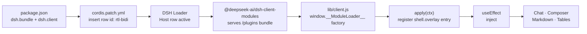

<div dir="rtl">

# dsh-rtl-bidi-plugin — اتجاه عربي/إنجليزي صحيح في DeepSeek Harness

**إضافة واجهة (Client Plugin) لمنصة [DeepSeek Harness](https://github.com/deepseek-ai) تجعل كل فقرة نصية تأخذ اتجاهها الصحيح تلقائياً، فيظهر النص العربي من اليمين إلى اليسار، والإنجليزي من اليسار إلى اليمين، دون أي تداخل بين اللغتين — داخل صندوق المحادثة وصندوق الكتابة وكل محتوى Markdown.**


---

## المشكلة

واجهة DeepSeek Harness مبنية باتجاه أساسي `LTR` (من اليسار لليمين). عندما تكتب جملة تخلط العربية والإنجليزية — مثل:

```
اشرح لي JavaScript closures بالعربي مع مثال
```

فإن متصفح الويب يعامل الفقرة كفقرة إنجليزية، فتظهر الكلمات العربية في ترتيب مقلوب أو تتقافز علامات الترقيم والأقواس بين اللغتين. المشكلة ليست في نص الرسالة نفسه، بل في **اتجاه السطر الواحد (paragraph base direction)** الذي يقرر ترتيب الكلمات والعلامات على الشاشة.

## ماذا تفعل الإضافة

- **لكل فقرة نصية اتجاه مستقل** يُستنتج من أول حرف قوي فيها: عربي → RTL، إنجليزي → LTR.
- **صندوق الكتابة تلقائي الاتجاه سطراً بسطر**: كل سطر ياخد اتجاهه من أول حرف قوي فيه، فتكتب سطراً عربياً وسطراً إنجليزياً في نفس الرسالة، وكل واحد منهما يظهر باتجاهه الصحيح. والسطر الجديد الفاضي يرث اتجاه السطر اللي فوقه.
- تشمل المعالجة: الفقرات، العناوين، القوائم النقطية والمرقمة، الاقتباسات، الجداول، وصفوف Markdown عموماً.
- **الأكواد والطرفية والرياضيات تبقى `LTR` دائماً** ومعزولة (isolated) — لأن اقتباس كود ظاهر من اليسار لليمين هو السلوك الصحيح حتى داخل نص عربي.
- لا تلمس منطق التطبيق ولا ملفات الجلسات ولا `app.asar`؛ التغيير عرضي محض (presentation-only).
- يعمل مع **أي لغة مختلطة** لا العربية/الإنجليزية فقط، لأن الآلية مبنية على معيار Unicode Bidirectional Algorithm (خوارزمية UBA، القواعد P2/P3).

## كيف تعمل — نظرة معمارية



الرسم يوضح المسار الكامل: **الحزمة (bundle)** تُعرّف صفاً في مُحمّل Cordis، ووحدة العميل تُقدَّم للمتصفح عبر خدمة `dsh-client-modules`، وعند تشغيلها تسجّل مكوّناً صامتاً في slot من نوع `shell.overlay` يملك تأثير الاتجاه طوال عمر الواجهة. التفاصيل الكاملة في [القسم التقني](#التفاصيل-التقنية).

## البنية

| الملف | الوظيفة |
|---|---|
| [`package.json`](package.json) | بيانات الحزمة: `dsh.bundle.patch` و`dsh.client` (platform: web) وبيانات العرض |
| [`cordis.patch.yml`](cordis.patch.yml) | طبقة patch تُدخل صفاً واحداً باسم `rtl-bidi` (يجب أن يكون داخل `insert:`) |
| [`lib/index.js`](lib/index.js) | نصف المضيف (Host): لا يفعل شيئاً — الإضافة عرضية بالكامل |
| [`lib/client.js`](lib/client.js) | نصف المتصفح (Client): حقن الأنماط، وضع `dir="auto"`، ومراقبة DOM |
| [`locale/en.json`](locale/en.json) | عنوان ووصف الإضافة كما يظهران في Settings → Plugins |
| [`icon.svg`](icon.svg) | أيقونة الإضافة |
| [`AGENTS.md`](AGENTS.md) | دليل كامل لأي ذكاء اصطناعي: كيف بُني المشروع، كيف يعمل، كيف يُعدَّل، وأفكار تطوير |

## التثبيت

### المتطلبات

- **DeepSeek Harness Desktop** (أو أي تشغيل لـ DSH بواجهة Web) بإصدار يدعم `dsh-client-modules` وslots الواجهة.
- الوصول إلى بروفايل DSH النشط (مثلاً `desktop`).

### الطريقة الرسمية (موصى بها)

التثبيت يمر عبر أداة `plugin_manager` الرسمية وليس بنسخ ملفات يدوياً. في أي جلسة وكيل داخل DSH اطلب:

> «ثبّت الحزمة المحلية الموجودة في `<مسار-هذا-المستودع>` باستخدام `plugin_manager` مع `action: install_bundle` و`target` = المسار المطلق للمجلد.»

أو نفّذها بنفسك عبر أداة الوكيل:

```text
plugin_manager({ action: "install_bundle", target: "<absolute-path-to-this-repo>" })
```

بعد نجاح التثبيت (يظهر `application: applied`) ستتحقق من ثلاث نقاط:

1. **في Config Inspector**: تظهر صفوف الحزمة:
   ```text
   cordis_inspect_query Config.listConfigs { "name": "rtl-bidi-plugin" }
   → entry: include:rtl-bidi  name: rtl-bidi-plugin
   ```
2. **في قائمة الحزم**: `plugin_manager list_bundles` يجب أن يُظهر الحزمة مع:
   ```json
   "rows": [{ "rowId": "rtl-bidi", "moduleName": "rtl-bidi-plugin" }]
   ```
   ⚠️ إذا كانت `"rows": []` فالـ patch لم تُطبَّق (راجع [استكشاف الأخطاء](#استكشاف-الأخطاء)).
3. **في الواجهة الحيّة**: `cordis_inspect_query` على `client Slots.listSubTree` مع `root: "shell.overlay"` يعرض عنصراً باسم `rtl-bidi` بحالة `active`.

> **لا تحتاج إعادة تشغيل** في العادة: تثبيت حزمة جديدة يستطيع التفعيل عبر HMR فتصل وحدة العميل للصفحة المفتوحة. إن لم تظهر التغييرات، أعد تشغيل DSH كاملاً.

### التثبيت اليدوي

غير موصى به. تعديل `package.json` أو `cordis.patch.yml` في البروفايل يدوياً قد يترك البروفايل في حالة متناقضة، وتُهمَل صفوف patch التي لا تُطابق نمط `insert:` **بصمت**. استخدم `plugin_manager` دائماً.

## التحقق من العمل

بعد التثبيت جرّب في المحادثة:

```text
اشرح Python decorators بالعربي مع مثال واذكر الكود
```

المتوقع:

- الفقرة العربية تصطف يميناً بترتيب كلمات صحيح.
- الكلمة الإنجليزية داخل الجملة العربية لا تقلب ترتيب ما حولها (فضلًا عن الترقيم).
- فقرة إنجليزية تصطف يساراً.
- كتلة الكود تبقى `LTR` معزولة.
- صندوق الكتابة يتبع أول حرف: عربي → يمين، إنجليزي → يسار.

## التفاصيل التقنية

### 1) الاتجاه لكل فقرة: UBA P2/P3

HTML يوفّر `dir="auto"`: يُستنتج الاتجاه من **أول حرف قوي** في النص (عربي/عبري → RTL، لاتيني → LTR). هذا هو التطبيق العملي لقاعدتي P2/P3 في خوارزمية Unicode للاتجاه، وهو نفس ما تفعله محرّرات النصوص ثنائية اللغة.

بعد استنتاج الاتجاه، تصبح قيمة `direction` المحسوبة للعنصر هي `rtl` أو `ltr`، و`text-align: start` تتبعها تلقائياً (يمين/يسار).

> ملاحظة مهمة: `direction: auto` **ليست قيمة CSS صحيحة**. الصحيح أن تُضبط بـ `dir="auto"` (سمة HTML) أو `unicode-bidi: plaintext` (خاصية CSS). استخدام قيمة غير صحيحة هو أحد أسباب فشل محاولات سابقة.

### 2) الأنماط التي تُحقن

```css
/* كل كتلة نصية: اتجاه مستقل + محاذاة تتبع الاتجاه */
p, li, ul, ol, h1, h2, h3, h4, h5, h6, blockquote, dd, dt,
figcaption, summary, td, th, caption, label {
  unicode-bidi: plaintext !important;
  text-align: start !important;
}

/* حاويات Markdown: مستوى الفقرة فقط، دون فرض اتجاه على صناديق التخطيط */
[class*="markdown"], [class*="_markdown_"], [class*="prose"],
[class*="messageText"], [class*="messageBody"], [class*="_bubble_"] {
  unicode-bidi: plaintext !important;
}

/* الأكواد والرياضيات: LTR معزولة دائماً */
pre, code, kbd, samp, var, .katex, .katex *,
[class*="shiki"], [class*="codeBlock"], [class*="_codeBlock"] {
  direction: ltr !important;
  unicode-bidi: isolate !important;
  text-align: left !important;
}

/* صندوق الكتابة: الاتجاه من أول حرف قوي في النص كله */
textarea, input[type="text"], input[type="search"],
[contenteditable="true"], [contenteditable=""], [data-composer-input] {
  unicode-bidi: plaintext !important;
  text-align: start !important;
  direction: start !important;
}

/* كل سطر داخل صندوق المحادثة يتبع اتجاه الصندوق نفسه */
[data-composer-input] p, [data-composer-input] li {
  unicode-bidi: plaintext !important;
  text-align: start !important;
  direction: inherit !important;
}
```

سبب وضع `dir` **داخل** المكوّن (Runtime) بدل الاكتفاء بـ CSS:CSS وحدها لا تُغيّر `direction` المحسوب، لذلك نضع السمة `dir="auto"` على كل كتلة. أما الحاويات الكبيرة فنكتفي لها بـ `unicode-bidi: plaintext` حتى لا نغيّر اتجاه صناديق `flex` فتنتقل الأيقونات والأزرار في غير مكانها.

### 2.1) صندوق المحادثة: لماذا `unicode-bidi` وحده لا يكفي

صندوق الكتابة في DSH ليس `textarea`، بل محرر **Lexical** (`contenteditable`) يضع كل سطر في `<p>` مستقل. وهذا يفسّر العَرَض الذي كان قائماً في 0.2:

- عند `Enter` يُنشئ Lexical **فقرة جديدة محتواها `<br>` فقط** — أي بلا أي حرف قوي. وقاعدة `unicode-bidi: plaintext` تعيد مستوى الفقرة إلى الموروث (`ltr`) حين لا تجد حرفاً قوياً، فيظهر المؤشر يساراً وتبدأ الكتابة العربية من اليسار، بينما السطر الأول (المكتوب فعلاً) يبدو صحيحاً.
- لهذا لا تصلح `unicode-bidi` وحدها؛ الحل هو ضبط **سمة `dir` صريحة** على سطح المحرر كله، فيتبعها كل سطر جديد تلقائياً.

### 2.2) محرّك اتجاه صندوق المحادثة (`applyComposerDirection`)

1. تُقرأ نصوص المحرر بترتيب الصفحة، مع تجاهل placeholder و«الشرائح» (chips) لأن نصها إنجليزي ولا يمثّل ما يكتبه المستخدم.
2. يتم **أول حرف قوي** (UBA P2/P3) — الأرقام والمسافات وعلامات الترقيم والرموز التعبيرية كلها محايدة.
3. تُضبط `dir="rtl"` أو `dir="ltr"` على عنصر المحرر؛ فإن كان السطر الحالي ما زال فارغاً **يبقى الاتجاه السابق**، فلا يقفز المؤشر بين Enter والحرف الأول.
4. يعاد الحساب **فورياً** على `input`, `keydown`, `keyup`, `compositionstart/end`, `paste`, `cut`, `drop`, `selectionchange` (قبل الرسم، لا بعد إطار)، وأيضاً بعد كل تغيير في DOM كخطة احتياطية.
5. أي `dir` يملكه المضيف بنفسه (مثل `dir="auto"` من إصدار مستقبلي) لا يُلمَس؛ وعند إلغاء التحميل يُعاد `dir` الأصلي بالضبط.

الاختبارات: `npm test` (Node فقط، بلا متصفح) تغطي قاعدة أول حرف قوي، والسلوك بعد `Enter`، وتبديل الاتجاه عربي↔إنجليزي، وتجاهل الشرائح، وعدم تجاوز `dir` المضيف، والتنظيف عند الإزالة.

### 3) وضع الاتجاه على العناصر (Runtime)

- تُمسح الصفحة عند التحميل، ثم يُراقَب DOM عبر `MutationObserver` (childList + subtree) لأن React يعيد بناء العُقد أثناء البث.
- كل عنصر جديد من الوسوم النصية يُعطى `dir="auto"` مرة واحدة، مع علامة `data-dsh-rtl-bidi="1"` للتنظيف.
- تُستثنى العناصر الواقعة داخل الأكواد والرياضيات (عبر `closest`).
- عند إلغاء التحميل: يُفصل المراقب، تُزال ورقة الأنماط، وتُزال سمات `dir` التي أضفناها فقط (لا نلمس `dir` الأصلي).

### 4) دورة حياة آمنة داخل slot

بدل كتابة DOM على مستوى الوحدة، نسجّل مكوّناً لا يرسم شيئاً (`return null`) في slot باسم `shell.overlay` (طبقة عائمة بعرض الإطار كله)، ونضع كل العمل داخل `useEffect`:

```js
function BidiDirection() {
  React.useEffect(() => install(), []); // يُنفَّذ عند التركيب، ويُنظّف عند الإزالة
  return null;
}

return {
  inject: ["slots"],
  apply(ctx) {
    ctx.slots.inject("shell.overlay", () =>
      ctx.slots.register({ name: "shell.overlay", id: "rtl-bidi", order: 100 }, BidiDirection),
    );
  },
};
```

الفائدة: يملك Cordis دورة الحياة، فيُزال التأثير تلقائياً عند تعطيل الإضافة أو إعادة تحميلها، ويظهر العنصر في فحص `Slots` مما يسهّل التحقق من أنه محمّل فعلاً.

## التخصيص السريع

| ماذا تريد؟ | أين تعدّل؟ |
|---|---|
| إضافة وسم HTML جديد (مثل `dl` أو `address`) | أضفه إلى `BLOCKS` وإلى قاعدة CSS معاً |
| استثناء عنصر من الاتجاه التلقائي | أضفه إلى `EXCLUDE` |
| تغيير محاذاة أو تباعد الأسطر | عدّل `CSS` داخل `lib/client.js` |
| تغيير اسم العنصر في `shell.overlay` | `id` في `ctx.slots.register` — اجعله فريداً |
| تعطيل عزل الأكواد | احذف قاعدة `pre, code...` — غير موصى به |

## استكشاف الأخطاء

| العَرَض | السبب الأرجح | الحل |
|---|---|---|
| لا يحدث أي تغيير بعد إعادة التشغيل | `cordis.patch.yml` يبدأ بـ `- id:` بدل `- insert:`، فيُعتبر override لصف غير موجود ويُتجاهل بصمت | أصلح الصيغة: `- insert: [{ id, name }]` ثم أعد التثبيت |
| `list_bundles` يُظهر `rows: []` | نفس السبب أعلاه | نفس الحل |
| الصف موجود لكن لا يظهر في `shell.overlay` | وحدة العميل لم تُقدَّم/لم تُنفَّذ؛ أو بقي إصدار قديم في HMR | عطّل الحزمة ثم فعّلها (`set_bundle`)، أو أعد تشغيل DSH |
| معرّف الوحدة لا يطابق الحزمة | `id` في `ModuleLoader.load` يجب أن يساوي `name` في `package.json` | وحّدهما |
| النص العربي ما زال يسارياً | `dir` يُضاف فقط للعناصر التي لا تملك `dir` مسبقاً، أو العنصر ليس من الوسوم المغطاة | أضف الوسم إلى `BLOCKS`، وتأكد أن العنصر ليس داخل `EXCLUDE` |
| الكود انقلب | قاعدة `pre, code` حُذفت أو عُدّلت | أعد قاعدة `direction: ltr; unicode-bidi: isolate` |
| صندوق المحادثة يبدأ يساراً، أو يقفز المؤشر لليسار بعد `Enter` | السطر الفارغ في Lexical لا يحتوي حرفاً قوياً، و`unicode-bidi: plaintext` تسقط على `ltr` الموروث | تأكد من وجود قاعدة `[data-composer-input] p … direction: inherit` **و**من `applyComposerDirection` (النسخة 0.3+) |
| الإضافة تختفي بعد إعادة تشغيل | الحزمة لم تُثبَّت رسمياً (تعديل يدوي) أو حُذف رابط `node_modules` | أعد التثبيت عبر `plugin_manager install_bundle` |

## حدود معروفة

- **الواجهة نفسها تبقى LTR** (القوائم الجانبية، الأزرار، الإعدادات). الإضافة تصحّح اتجاه النصوص فقط، وليس تحويل التطبيق لواجهة عربية كاملة.
- **الأكواد والطرفية والرياضيات LTR قصداً** — هذا هو الصحيح تقنياً ولا يجب تغييره.
- عارض المستندات (PDF/صور/Office) له عرضه المستقل ولا يتأثر.
- بعض إضافات الطرف الآخر التي ترسم نصاً داخل `div` بلا وسوم فقرة قد لا تلتقطها المحددات العامة.
- تعتمد جزئياً على أسماء كلاسات CSS داخلية (`_markdown_`) كطبقة احتياطية؛ لكن المحددات الأساسية مبنية على وسوم HTML القياسية، فتبقى صالحة غالباً بعد تحديثات الواجهة.

## المساهمة

المساهمات والاقتراحات مرحّب بها عبر Issues أو Pull Requests. قبل أي PR:

1. تأكد أن `node --check lib/client.js` يمر.
2. تأكد أن `npm test` يمر (بلا اعتماديات).
3. تأكد أن `id` في `lib/client.js` ما زال مطابقاً لاسم الحزمة.
4. جرّب mixed text في المحادثة وصندوق الكتابة، وتأكد أن كتل الكود ما زالت LTR.
5. حدّث `version` في `package.json` و`dsh.bundle.version` معاً، وحدّث `AGENTS.md` إن غيّرت العقود.

## الترخيص

[MIT](LICENSE) © 2026 Hany Hassan

---

# English overview

**dsh-rtl-bidi-plugin** is a presentation-only client plugin for **DeepSeek Harness** that fixes mixed Arabic/English text direction. The DSH Web UI is LTR by default, so a paragraph mixing Arabic and English renders with scrambled word order and punctuation. This plugin gives **every text block its own base direction** (Unicode UBA P2/P3) by setting `dir="auto"` plus `unicode-bidi: plaintext`, while keeping code, terminal output and math **LTR and isolated**. It also makes the composer direction-aware.

- **Install**: through the official `plugin_manager` tool — `install_bundle` with this repository's absolute path as `target`. Do not hand-edit the profile.
- **Verify**: Host row `rtl-bidi` active, client bundle registered, and a `rtl-bidi` occupant in the `shell.overlay` slot.
- **Design**: the bundle patch *inserts* one Host row (`insert:` is mandatory — a bare row is treated as an override and silently skipped); the client half registers a no-op React component in `shell.overlay` whose effect injects the stylesheet, tags blocks with `dir="auto"`, and observes DOM mutations; cleanup is owned by `useEffect`/`ctx.slots`.
- **Composer (v0.3)**: the chat box is a Lexical `contenteditable`, and each line is its own `<p>`. A new line holds only an `<br>`, i.e. no strong character, so `unicode-bidi: plaintext` alone falls back to the inherited LTR for exactly that line — the first line looked right, Enter moved the caret to the left. The plugin now keeps an explicit `dir` attribute derived from the first strong character of the whole composer text, re-applied synchronously on `input`/selection events, and carries the previous direction while the current line is still empty. Tests: `npm test`.
- **Limitations**: app chrome stays LTR; code/math stay LTR by design; document previews unaffected.

**For AI agents**: read [`AGENTS.md`](AGENTS.md) — it documents the contracts, build/verify workflow, failure history, modification guide, and an ideas backlog.

</div>
